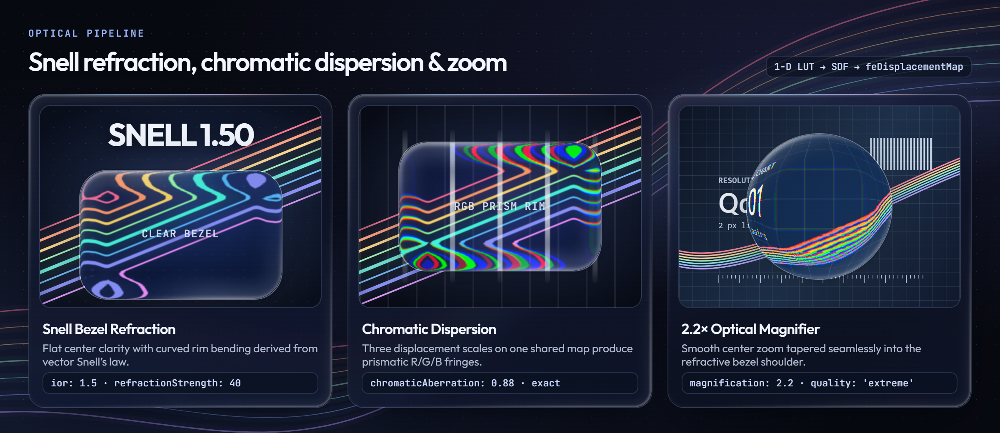
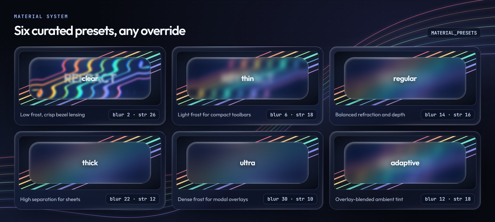
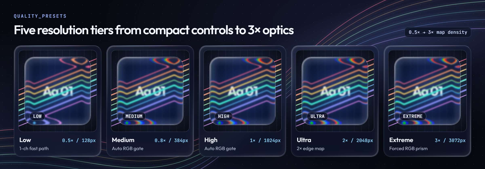

<p align="center">
  
</p>

<p align="center">
  <a href="https://www.npmjs.com/package/quick-liquid"></a>
  <a href="https://www.npmjs.com/package/quick-liquid"></a>
  <a href="https://www.npmjs.com/package/quick-liquid"></a>
  <a href="https://www.npmjs.com/package/quick-liquid"></a>
  <a href="https://quickliquid.vercel.app"></a>
  <a href="LICENSE"></a>
</p>

<p align="center">
  <b>Ultra-fast refractive liquid glass for React and vanilla JavaScript.</b><br />
  Precomputed Snell LUT optics, chromatic dispersion, 1×–3× magnification, SDF metaball merging, and spring-driven UI primitives.
</p>

<p align="center">
  <a href="https://quickliquid.vercel.app"><b>Live Site</b></a>
  &middot;
  <a href="https://quickliquid.vercel.app/playground/"><b>Interactive Playground</b></a>
  &middot;
  <a href="https://quickliquid.vercel.app/docs/"><b>API Docs</b></a>
  &middot;
  <a href="https://skills.sh/amarnath3003/quickliquid/quick-liquid"><b>Agent Skill</b></a>
  &middot;
  <a href="packages/quick-liquid/PHYSICS.md"><b>Physics Notes</b></a>
  &middot;
  <a href="https://www.npmjs.com/package/quick-liquid"><b>npm</b></a>
</p>

<p align="center">
  <a href="https://quickliquid.vercel.app/playground/">
    
  </a>
</p>

## Visual Showcase

<p align="center">
  <a href="assets/showcase-optics.png"></a><br />
  <b>Optics, Dispersion &amp; 1×–3× Zoom</b> &mdash; Vector Snell bezels, shared-map RGB prism rims, and optical magnification.
</p>

<p align="center">
  <a href="assets/showcase-materials.png"></a><br />
  <b>6 Curated Material Presets</b> &mdash; <code>clear</code>, <code>thin</code>, <code>regular</code>, <code>thick</code>, <code>ultra</code>, and <code>adaptive</code> tuned out of the box.
</p>

<p align="center">
  <a href="assets/showcase-quality.png"></a><br />
  <b>5 Quality Tiers (<code>QUALITY_PRESETS</code>)</b> &mdash; Scale from lightweight <code>0.5×</code> controls up to <code>3×</code> supersampled hero optics.
</p>

<p align="center">
  <a href="assets/showcase-controls.png"></a><br />
  <b>React UI Primitives</b> &mdash; <code>LiquidGlassButton</code>, <code>LiquidSegmented</code>, <code>LiquidToggle</code>, <code>LiquidSwitcher</code>, and <code>useLiquidFlow</code>.
</p>

<p align="center">
  <a href="assets/showcase-motion.gif"></a><br />
  <b>Analytical Spring Physics</b> &mdash; Bounded jelly pills, droplet switch stretch, water ripples, and scroll tracking.
</p>

<p align="center">
  <a href="assets/showcase-droplets.gif"></a><br />
  <b>SDF Metaball Merging (<code>LiquidGroup</code>)</b> &mdash; Continuous smooth-min glass bridges and specular rims as droplets meet.
</p>

---

## Install

```bash
npm install quick-liquid
```

Zero runtime dependencies · Node 18+ · React 18+ optional for `quick-liquid/react`.

## Agent Skill

Install the QuickLiquid skill in your website project to give your coding agent integration examples, material and optics guidance, motion patterns, and browser diagnostics.

```bash
npx skills add amarnath3003/quickLiquid --skill quick-liquid
```

After installing, try this prompt in your coding agent.

```text
Use $quick-liquid to add a frosted navigation bar to this website.
```

From a local clone, use `npx skills add . --skill quick-liquid`. [View on skills.sh](https://skills.sh/amarnath3003/quickliquid/quick-liquid) · [Read the skill source](skills/quick-liquid/SKILL.md).

## Quick Start

### React

```tsx
import { LiquidGlass } from 'quick-liquid/react';

export function GlassCard() {
  return (
    <LiquidGlass
      config={{
        material: 'clear',
        appearance: 'dark',
        quality: 'high',
        refractionStrength: 32,
        chromaticAberration: 0.24,
      }}
      liquidPress
    >
      <div className="card">Hello, glass.</div>
    </LiquidGlass>
  );
}
```

### Vanilla DOM

```ts
import { LiquidGlassEngine } from 'quick-liquid';

const card = document.querySelector<HTMLElement>('.card');

if (card) {
  const glass = new LiquidGlassEngine(card, {
    material: 'clear',
    refractionStrength: 32,
    cursorTracking: true,
  });

  glass.enableLiquidPress();
}
```

---

## Interactive Docs & Entry Points

The **[live API documentation](https://quickliquid.vercel.app/docs/)** and **[interactive playground](https://quickliquid.vercel.app/playground/)** cover everything interactively:

- **All 30 `LiquidGlassConfig` options** with live search, sliders, and specimen preview (`blur`, `refractionStrength`, `magnification`, `dispersionMode`, `quality`, `appearance`, `respectPreferences`, etc.)
- **6 material presets** (`clear`, `thin`, `regular`, `thick`, `ultra`, `adaptive`) and **5 quality tiers** (`low`, `medium`, `high`, `ultra`, `extreme`)
- **14 animation & gesture primitives** (`Spring`, `SPRING_PRESETS`, `LiquidInteractive`, `LiquidSwitch`, `LiquidMorphModal`, `LiquidPopover`, `LiquidContentSwap`, `LiquidScrollTrack`, `LiquidTabBar`, `LiquidGroup`, `LiquidGesture`)

| Subpath | What's inside |
| --- | --- |
| `quick-liquid` | `LiquidGlassEngine`, presets, springs, gestures, `LiquidTabBar`, `LiquidGroup`, and interactive motion controllers |
| `quick-liquid/core` | Lean `LiquidGlassEngine`, presets, and config types without animation utilities |
| `quick-liquid/react` | `LiquidGlass`, `useLiquidGlass`, `LiquidGlassButton`, `LiquidSegmented`, `LiquidToggle`, `LiquidSwitcher`, `useLiquidInteractive`, `useLiquidFlow` |

## Browser Notes & Performance

- **Chromium refraction**: Full `backdrop-filter: url(...)` bending runs in Chromium. Keep glass host elements free of `isolation`, `filter`, `opacity < 1`, and `mask`.
- **Cross-browser support**: Pass `opticalSource` on `<LiquidGlass>` to filter React-drawn scenery directly in any browser, or use `refractionMode: 'css'` (automatic fallback in Safari/Firefox) for frost, tint, and rim lighting.
- **Cache-first pipeline**: Displacement maps tabulate a 512-sample 1-D Snell LUT, iterate only the rounded bezel band with 4-way symmetry, and share refcounted maps across matching geometries.

## Local Development

```bash
npm install
npm test              # run optics & animation tests
npm run typecheck     # type-check packages/quick-liquid
npm run build         # build library, demo, and landingPage
npm run dev:landing   # start the landing + docs + playground site
```

To regenerate the README showcase PNGs and GIFs from [demo/readme-studio.html](demo/readme-studio.html):

```bash
node scripts/render-readme-assets.cjs
```

## Documentation & License

- [Live API Docs](https://quickliquid.vercel.app/docs/) · [Interactive Playground](https://quickliquid.vercel.app/playground/)
- [Package README](packages/quick-liquid/README.md) · [Landing Page README](landingPage/README.md)
- [Physics notes](packages/quick-liquid/PHYSICS.md) · [Optimization notes](packages/quick-liquid/OPTIMIZATION.md)
- **License**: MIT — see [LICENSE](LICENSE).
