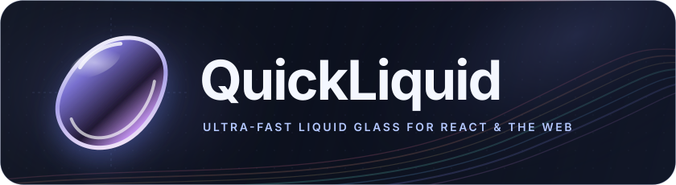
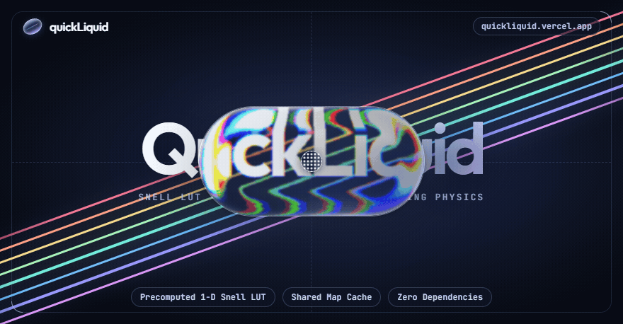
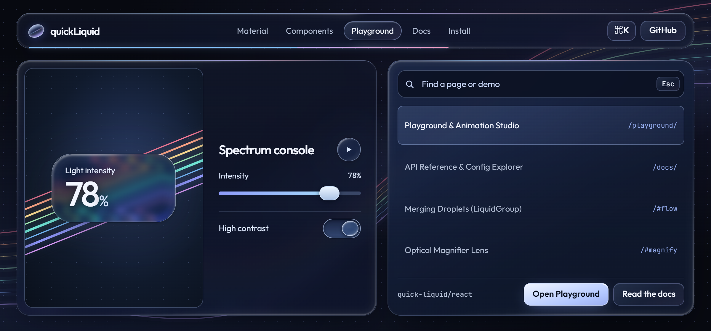
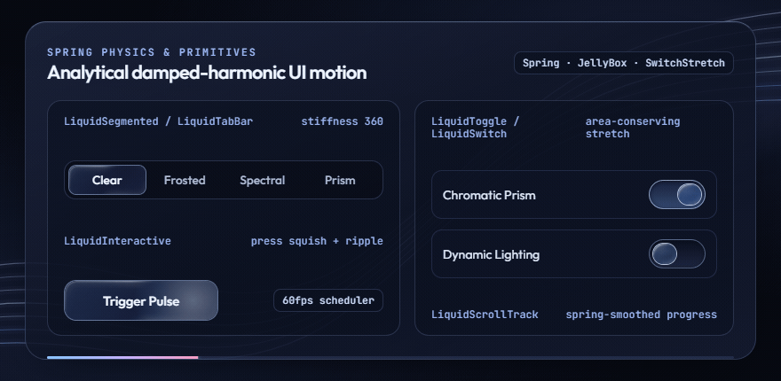
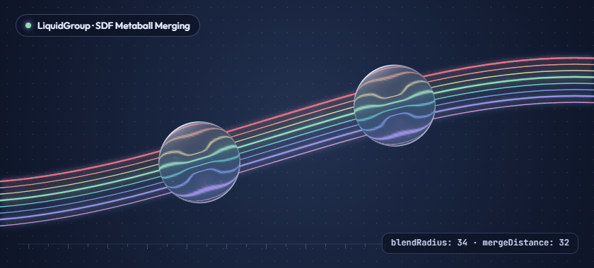

<p align="center">
  
</p>

<p align="center">
  <a href="https://www.npmjs.com/package/quick-liquid"></a>
  <a href="https://bundlephobia.com/package/quick-liquid"></a>
  <a href="https://www.npmjs.com/package/quick-liquid"></a>
  <a href="https://www.npmjs.com/package/quick-liquid"></a>
  <a href="https://www.npmjs.com/package/quick-liquid"></a>
  <a href="https://quickliquid.vercel.app"></a>
  <a href="LICENSE"></a>
</p>

<p align="center">
  <b>Ultra-fast refractive liquid glass for React and vanilla JavaScript.</b><br />
  Precomputed Snell LUT optics, chromatic dispersion, 1×–3× optical magnification, SDF metaball merging, and spring-driven UI primitives.
</p>

<p align="center">
  <a href="https://quickliquid.vercel.app"><b>Live Site</b></a>
  &middot;
  <a href="https://quickliquid.vercel.app/playground/"><b>Interactive Playground</b></a>
  &middot;
  <a href="https://quickliquid.vercel.app/docs/"><b>API Docs</b></a>
  &middot;
  <a href="packages/quick-liquid/PHYSICS.md"><b>Physics Notes</b></a>
  &middot;
  <a href="packages/quick-liquid/OPTIMIZATION.md"><b>Optimization Notes</b></a>
  &middot;
  <a href="https://www.npmjs.com/package/quick-liquid"><b>npm</b></a>
</p>

<p align="center">
  <a href="https://quickliquid.vercel.app/playground/">
    
  </a>
</p>

<p align="center">
  <a href="https://quickliquid.vercel.app/playground/"><b>Open Interactive Playground</b></a>
  &middot;
  <a href="https://quickliquid.vercel.app/docs/"><b>Explore Live API Docs</b></a>
  &middot;
  <a href="assets/quick-liquid-live-intro.mp4"><b>Full Intro (MP4)</b></a>
</p>

---

## Why QuickLiquid

QuickLiquid is a zero-dependency refractive UI and spring-motion engine for nav bars, command palettes, segmented pills, switches, cards, magnifiers, and merging droplets. It ships as a React primitive suite (`quick-liquid/react`), a full DOM + animation toolkit (`quick-liquid`), and a lean core engine (`quick-liquid/core`).

<table>
  <tr>
    <td width="33%">
      <p align="center"></p>
      <b>Physical Snell refraction</b><br />
      A 1-D Snell lookup table and rounded-rect SDF bend backdrops cleanly through convex bezels while keeping the flat center distortion-free—or zooming up to <code>3×</code> via <code>magnification</code>.
    </td>
    <td width="33%">
      <p align="center"></p>
      <b>Analytical spring physics</b><br />
      Closed-form harmonic springs drive button squish, water ripples, jelly tab pills, droplet switches, directional content swaps, and modal reveals with zero integration drift.
    </td>
    <td width="33%">
      <p align="center"></p>
      <b>Refcounted map cache</b><br />
      Same-geometry glass surfaces share one 8-bit Bayer-dithered displacement map, and strength/dispersion tweaks update filter attributes in place without rebuilding maps.
    </td>
  </tr>
  <tr>
    <td width="33%">
      <p align="center"></p>
      <b>Chromatic prism rims</b><br />
      Red, green, and blue channels sample the same map at physical crown-glass offsets, automatically gated under heavy frost unless <code>dispersionMode: 'exact'</code> or <code>extreme</code> quality is chosen.
    </td>
    <td width="33%">
      <p align="center"></p>
      <b>SDF droplet merging</b><br />
      <code>LiquidGroup</code> paints a shared height-field glass surface with smooth-min bridges, specular rims, and optional 2D canvas backdrop sampling as droplets approach.
    </td>
    <td width="33%">
      <p align="center"></p>
      <b>Drop-in React &amp; DOM UI</b><br />
      Ready-to-use <code>LiquidGlassButton</code>, <code>LiquidSegmented</code>, <code>LiquidToggle</code>, <code>LiquidSwitcher</code>, <code>useLiquidFlow</code>, plus cross-browser <code>opticalSource</code> filtering.
    </td>
  </tr>
</table>

---

## Optics, Dispersion & Magnification

QuickLiquid computes displacement along a convex circular-arc bezel using vector Snell's law (`ior`, `thickness`, `bezelWidth`), tapers center zoom smoothly into the shoulder when `magnification > 1`, and splits R/G/B channels from one shared displacement map.

<p align="center">
  
</p>

- **`Snell Bezel Refraction`**: Keeps the flat interior razor-clear while bending lines smoothly across the rounded bezel (`ior`, `bezelWidth`, `thickness`, `refractionStrength`).
- **`Chromatic Dispersion`**: Uses one shared map across three `feDisplacementMap` scales (`dispersionMode: 'auto' | 'exact'`). Automatic gating skips redundant RGB passes under heavy frost for 6× lighter filter work.
- **`1×–3× Optical Magnifier`**: Set `magnification` from `1` to `3` to enlarge content through the lens center while blending seamlessly into the refracted edge.
- **Cross-browser `opticalSource`**: Pass a lens-aligned scene as the `opticalSource` prop on `<LiquidGlass>` to apply the SVG optical filter directly inside any browser—even outside Chromium's live `backdrop-filter: url()` path.

---

## Material Presets

Start with one of six curated presets via `material`, then override any knob (`blur`, `refractionStrength`, `tintOpacity`, etc.).

<p align="center">
  
</p>

| Preset | Blur | Refraction | Saturation | Tint Opacity | Best for |
| --- | --- | --- | --- | --- | --- |
| `clear` | `2` | `26` | `1.55` | `0.03` | Hero lenses, docks, and vivid media backdrops |
| `thin` | `6` | `18` | `1.5` | `0.05` | Toolbars, chips, segmented pills, compact controls |
| `regular` | `14` | `16` | `1.7` | `0.09` | Cards, sticky navigation bars, command palettes |
| `thick` | `22` | `12` | `1.8` | `0.13` | Side sheets, popovers, text-heavy panes |
| `ultra` | `30` | `10` | `1.85` | `0.17` | Large modal overlays and elevated surfaces |
| `adaptive` | `12` | `18` | `1.6` | `0.06` | Surfaces using overlay tint blending (`adaptiveTint: true`) |

---

## Render Quality Tiers (`QUALITY_PRESETS`)

Five quality tiers trade displacement map density (`samples / CSS px`) and longest-side pixel caps against memory and preparation speed.

<p align="center">
  
</p>

| Tier | Density | Longest-side cap | Dispersion behavior | Ideal use |
| --- | --- | --- | --- | --- |
| `low` | `0.5×` | `128 px` | Always single-channel (`1-ch`) | Dense micro-controls, toggle thumbs, small badges |
| `medium` | `0.8×` | `384 px` | Frost-gated RGB (`auto` / `exact`) | Navigation bars, buttons, cards, segmented controls |
| `high` *(default)* | `1×` | `1024 px` | Frost-gated RGB (`auto` / `exact`) | Standard panels, sheets, interactive lenses |
| `ultra` | `2×` | `2048 px` | Frost-gated RGB (`auto` / `exact`) | Hero lenses and high-DPI curved surfaces |
| `extreme` | `3×` | `3072 px` | Forces full RGB at any positive dispersion | Magnifiers, optical showcases, rainbow prism lenses |

---

## Install

```bash
npm install quick-liquid
```

<details>
<summary>Other package managers (pnpm, yarn, bun)</summary>

```bash
pnpm add quick-liquid
yarn add quick-liquid
bun add quick-liquid
```

</details>

Requirements:
- Node 18+ for local builds
- React 18+ only when importing `quick-liquid/react`
- Zero runtime dependencies and no stylesheet import required

---

## Quick Start

### React (`quick-liquid/react`)

```tsx
import { LiquidGlass } from 'quick-liquid/react';

export function CommandCard() {
  return (
    <LiquidGlass
      config={{
        material: 'regular',
        appearance: 'dark',
        quality: 'high',
        borderRadius: 24,
        chromaticAberration: 0.24,
        cursorTracking: true,
      }}
      liquidPress={{ scale: 0.94, squish: 0.03 }}
      animateIn={120}
      className="command-glass"
    >
      <button type="button">Open Command Center</button>
    </LiquidGlass>
  );
}
```

Or use the lightweight ref hook `useLiquidGlass`:

```tsx
import { useLiquidGlass } from 'quick-liquid/react';

export function FrostedBanner() {
  const { ref } = useLiquidGlass<HTMLDivElement>({ material: 'thin', borderRadius: 20 });
  return <div ref={ref}>Refractive surface</div>;
}
```

### Vanilla DOM (`quick-liquid` / `quick-liquid/core`)

```ts
import { LiquidGlassEngine } from 'quick-liquid';

const card = document.querySelector<HTMLElement>('[data-liquid-card]');

if (card) {
  const glass = new LiquidGlassEngine(card, {
    material: 'clear',
    refractionStrength: 28,
    cursorTracking: true,
    quality: 'ultra',
  });

  glass.enableLiquidPress({ scale: 0.94, squish: 0.025 });

  // Merge overrides vs. replace full declaration:
  glass.updateConfig({ blur: 8 });
  glass.updateConfig({ blur: undefined }); // clears explicit blur back to preset
  glass.setConfig({ material: 'regular' });
}
```

---

## React UI Primitives (`quick-liquid/react`)

QuickLiquid ships composable, accessible React primitives backed by live `LiquidGlass` surfaces and analytical spring controllers—powering the [quickliquid.vercel.app](https://quickliquid.vercel.app) interface itself.

<p align="center">
  
</p>

```tsx
import { useRef, useState } from 'react';
import {
  LiquidGlassButton,
  LiquidSegmented,
  LiquidSwitcher,
  LiquidToggle,
  useLiquidFlow,
} from 'quick-liquid/react';

export function GlassToolbar() {
  const [mode, setMode] = useState<'clear' | 'regular' | 'thick'>('clear');
  const [prism, setPrism] = useState(true);
  const triggerRef = useRef<HTMLButtonElement>(null);
  const dialogRef = useRef<HTMLDialogElement>(null);
  const { openFrom } = useLiquidFlow({ mode: 'drop', sheen: true });

  return (
    <>
      <LiquidSegmented
        options={[
          { value: 'clear', label: 'Clear' },
          { value: 'regular', label: 'Regular' },
          { value: 'thick', label: 'Thick' },
        ]}
        value={mode}
        onChange={setMode}
        glass
        ariaLabel="Material preset"
      />

      <LiquidToggle checked={prism} onChange={setPrism} label="Chromatic prism" />

      <LiquidSwitcher activeKey={mode} direction={1}>
        <code>{`material: "${mode}"`}</code>
      </LiquidSwitcher>

      <LiquidGlassButton
        ref={triggerRef}
        glass
        onClick={() => dialogRef.current && openFrom(triggerRef.current, dialogRef.current, () => dialogRef.current?.showModal())}
      >
        Command Menu
      </LiquidGlassButton>
    </>
  );
}
```

| Primitive / Hook | Purpose |
| --- | --- |
| `<LiquidGlass>` | Declarative wrapper with `config`, `as`, `active`, `opticalSource`, `liquidPress`, `animateIn`, `jiggle`, `onPerformanceUpdate`, and imperative `LiquidGlassRef`. |
| `useLiquidGlass(config)` | Attaches `LiquidGlassEngine` to any ref and exposes `engine` + `getMetrics()`. |
| `<LiquidGlassButton>` | Non-blocking magnetic hover sheen, press squish, expanding ripple, and optional `glass` lens layer (renders `<button>` or `<a>`). |
| `<LiquidSegmented>` | Horizontal or vertical segmented control / `tablist` driven by `LiquidTabBar` with bounded jelly pill physics. |
| `<LiquidToggle>` | Accessible `role="switch"` backed by `LiquidSwitch` velocity-coupled droplet stretch and a `LiquidGlass` thumb. |
| `<LiquidSwitcher>` | Directional spring content swap (`direction: -1 \| 0 \| 1`) via `LiquidContentSwap`. |
| `useLiquidInteractive(cfg)` | Attaches `LiquidInteractive` sheen, magnetic lift, press squish, and ripples to any ref. |
| `useLiquidFlow(cfg)` | Manages `LiquidMorphModal` (`'drop'` or shared-element `'flow'`) lifecycle with glass sheen sweeps. |

---

## Spring Physics & Interactive Motion

Every interactive surface runs on `AnimationScheduler.shared()` and an analytical closed-form `Spring` solver—zero timestep drift, full velocity carry-over, and bounded jelly/stretch kinematics.

<p align="center">
  
</p>

### Key Motion Controllers

- **`LiquidInteractive`** — Non-blocking hover sheen (`--ql-hx`, `--ql-hy`, `--ql-hover`), magnetic pull, press squish, and water ripples without capturing pointer events.
- **`LiquidTabBar`** — GPU-composited glass pill (`glass`, `orientation`, `hoverFollower`, `stretch`) constrained inside container walls by `computeBoundedJellyBox`.
- **`LiquidSwitch`** — Spring-driven toggle thumb with area-conserving droplet stretch (`computeSwitchStretch`).
- **`LiquidMorphModal`** — `'drop'` surface-tension modal reveal with optical glass sheen sweep, or `'flow'` shared-element flight from trigger rect (`computeFlowRect`).
- **`LiquidPopover`** — Spring-blooming dropdowns (`open`, `close`) plus `LiquidPopover.bindList()` gliding hover highlight across `[role="option"]`.
- **`LiquidContentSwap`** — Directional spring transitions (`animateSwap`) for swapping code panels, tabs, and views.
- **`LiquidScrollTrack`** — Spring-smoothed horizontal or vertical scroll indicator for sticky navbars and scrollable lists.
- **`LiquidGesture` / `LiquidButton` / `LiquidDrag`** — Rubber-banded drag gestures with flick velocity carry-over and spring release.
- **`Spring` / `SpringVector` / `SPRING_PRESETS`** — `'default'`, `'snappy'`, `'bouncy'`, `'gentle'`, `'stiff'`, `'liquidMerge'`, `'liquidSplit'`.
- **Pure math exports** — `computeFlowRect`, `computeLiquidDropTransform`, `computeSwitchStretch`, `computeBoundedJellyBox` for custom deterministic timelines or tests.

```ts
import { LiquidTabBar, LiquidScrollTrack, Spring } from 'quick-liquid';

const bar = new LiquidTabBar(navEl, tabEls, {
  glass: true,
  hoverFollower: true,
  stretch: 0.18,
  spring: 'bouncy',
});

const tracker = new LiquidScrollTrack(window, progressBarEl, {
  orientation: 'horizontal',
});
```

---

## SDF Metaball Droplet Merging (`LiquidGroup`)

`LiquidGroup` computes a shared signed-distance height field (`sdfRoundedRect` + cubic `smoothMin`) across grouped elements, painting continuous refractive liquid bridges, specular highlights, and optional 2D canvas backdrop sampling as shapes come together.

<p align="center">
  
</p>

```ts
import { LiquidGroup, LiquidGesture } from 'quick-liquid';

const container = document.querySelector<HTMLElement>('.dock');
const items = document.querySelectorAll<HTMLElement>('.dock-item');

if (container) {
  const group = new LiquidGroup(container, {
    mergeDistance: 32,
    blendRadius: 34,
    bridgeOpacity: 0.78,
    bridgeColor: 'rgba(130, 175, 232, 0.22)',
    bridgeRimColor: 'rgba(232, 246, 255, 0.96)',
    bridgeRimWidth: 1.4,
    // backdrop: sceneCanvas, // optional origin-clean 2D canvas for direct pixel refraction
  });

  items.forEach((item) => {
    group.add(item);
    new LiquidGesture(item).onDrag(() => group.updatePositions());
  });
}
```

---

## Configuration Reference

All 30 `LiquidGlassConfig` properties (plus legacy alias `distortionStrength` → `refractionStrength`, `adaptiveTint`, and `tintStrength`):

| Option | Type | Default | Description |
| --- | --- | --- | --- |
| `material` | `'clear' \| 'thin' \| 'regular' \| 'thick' \| 'ultra' \| 'adaptive'` | unset | Applies a curated glass preset. Explicit keys always win. |
| `appearance` | `'light' \| 'dark' \| 'auto'` | `'auto'` | Adapts tint, lighting, and glow/shadow to light or dark backdrops (`auto` tracks `prefers-color-scheme`). |
| `blur` | `number` | `3` | Backdrop frost blur in CSS pixels (`0..80`). |
| `saturation` | `number` | `1.5` | Backdrop color saturation boost (`0..4`). |
| `tint` | `string` | `'255, 255, 255'` | RGB tint string; dark appearance swaps default white to deep smoke. |
| `tintOpacity` | `number` | `0.04` | Material tint layer opacity (`0..1`). |
| `refractionStrength` | `number` | `22` | Maximum rim displacement in CSS pixels (`0..150`, `0` disables). |
| `bezelWidth` | `number` | `34` | Width of the curved refractive bezel band (`0.5..256`). |
| `thickness` | `number` | `24` | Virtual glass slab depth shaping falloff and shadow (`0.1..256`). |
| `ior` | `number` | `1.5` | Index of refraction for vector Snell tracing (`1..3`). |
| `magnification` | `number` | `1` | Optical center zoom from `1` to `3`, tapered into the bezel shoulder. |
| `chromaticAberration` | `number` | `0.18` | Per-channel R/G/B dispersion split (`0..1`). |
| `dispersionMode` | `'auto' \| 'exact'` | `'auto'` | `auto` skips RGB splitting under heavy frost; `exact` keeps all 3 channels (`low` uses `1-ch`, `extreme` forces RGB). |
| `lightAngle` | `number` | `-35` | Light direction in degrees (`0` = top). |
| `edgeHighlight` | `number` | `0.9` | Crisp two-lobe conic rim highlight intensity (`0..1`). |
| `specularStrength` | `number` | `0.26` | Soft bezel sheen reflection intensity (`0..1`). |
| `fresnelPower` | `number` | `2.2` | Rim lobe tightness (`1..6`). |
| `backdropLuminance` | `number` | unset | Optional `0..1` luminance hint overriding `appearance` for rim/sheen derivation. |
| `hoverLighting` | `boolean` | `false` | Brightens rim lighting on pointer hover. |
| `cursorTracking` | `boolean` | `false` | Rotates rim and sheen lobes toward the cursor. |
| `dynamicLighting` | `boolean` | `false` | Alias enabling `cursorTracking`. |
| `parallax` | `boolean` | `false` | Adds subtle pointer depth shift to glass content. |
| `inertia` | `boolean` | `true` | Spring-smooths interactive light and parallax responses. |
| `elevation` | `number` | `1` | Drop shadow / dark ambient glow multiplier (`0..5`). |
| `noiseOpacity` | `number` | `0` | Optional micro-grain frost texture opacity (`0..1`). |
| `noiseScale` | `number` | `1` | Scale of the micro-noise texture (`0.1..10`). |
| `borderRadius` | `number` | `28` | Glass corner radius in CSS pixels (`0..10000`). |
| `quality` | `'low' \| 'medium' \| 'high' \| 'ultra' \| 'extreme'` | `'high'` | Map resolution tier (`0.5×/128` up to `3×/3072`). |
| `refractionMode` | `'auto' \| 'svg' \| 'css'` | `'auto'` | SVG displacement refraction or explicit CSS frost + lighting fallback. |
| `respectPreferences` | `boolean` | `true` | Honors system `prefers-reduced-motion` and `prefers-reduced-transparency` in the glass engine. |

---

## Import Map

| Subpath | Exports |
| --- | --- |
| `quick-liquid` | `LiquidGlassEngine`, `DEFAULT_CONFIG`, `MATERIAL_PRESETS`, `QUALITY_PRESETS`, `Spring`, `SpringVector`, `SPRING_PRESETS`, `AnimationScheduler`, `LiquidInteractive`, `LiquidSwitch`, `LiquidMorphModal`, `LiquidPopover`, `LiquidContentSwap`, `LiquidScrollTrack`, `LiquidGroup`, `LiquidTabBar`, `LiquidGesture`, `LiquidButton`, `LiquidDrag`, `LiquidMorph`, `LiquidMetaball`, `generateMergeBlob`, `LiquidTransition`, `LiquidLayoutAnimation`, `computeFlowRect`, `computeLiquidDropTransform`, `computeSwitchStretch`, `computeBoundedJellyBox`, and types (`GlassQuality`, `LiquidGlassConfig`, etc.) |
| `quick-liquid/core` | `LiquidGlassEngine`, `DEFAULT_CONFIG`, `MATERIAL_PRESETS`, `QUALITY_PRESETS`, `GlassQuality`, `LiquidGlassConfig` (no animation module overhead) |
| `quick-liquid/react` | `LiquidGlass`, `useLiquidGlass`, `LiquidGlassButton`, `LiquidSegmented`, `LiquidToggle`, `LiquidSwitcher`, `useLiquidInteractive`, `useLiquidFlow`, `LiquidGlassProps`, `LiquidGlassRef`, and primitive prop types |

ESM and CJS bundles are built with `tsup` and share one map cache within each module graph.

---

## Interactive Playground & Live Docs

Explore the redesigned dark-spectral web experience at **[quickliquid.vercel.app](https://quickliquid.vercel.app)**:

- **Home ([`/`](https://quickliquid.vercel.app/))** — Interactive `SpectrumLab` draggable lens, Spectrum Console, live SDF `FlowExperiment` droplet merging, `ZoomExperiment` optical magnifier, and framework install switcher.
- **Playground ([`/playground/`](https://quickliquid.vercel.app/playground/))** — Tune materials across 6 test backdrops (`Spectrum`, `Video`, `Photo`, `Type`, `Fine lines`, `Contrast`), switch `QUALITY_PRESETS`, reshape lenses (`card`, `pill`, `circle`), copy generated `<LiquidGlass>` JSX, and test live spring curves inside the **Animation Studio**.
- **API Docs ([`/docs/`](https://quickliquid.vercel.app/docs/))** — Searchable 30-property `LiquidGlassConfig` explorer with live specimen preview, Material presets comparator, interactive `LiquidGlassRef` sandbox with live performance metrics, metaball tuner, and 14-item Animation Toolkit gallery.

---

## Browser Notes & Performance Model

- **Chromium `backdrop-filter: url()`**: Full live DOM refraction renders in Chromium-based browsers. Keep glass host elements free of `isolation: isolate`, `filter`, `opacity < 1`, `mask`, and explicit stacking changes on `.ql-lens` so Chromium preserves the live backdrop readback.
- **Cross-browser `opticalSource` & Fallback**: Provide a lens-aligned scene via `<LiquidGlass opticalSource={...}>` to filter React-rendered scenery directly in any browser. For arbitrary DOM in Safari/Firefox, `refractionMode: 'auto'` falls back gracefully to blur, saturation, tint, rim lighting, and shadow (or set `refractionMode: 'css'`).
- **Cache-first & Attribute-only Updates**:
  - Displacement maps tabulate the 1-D Snell profile into a 512-entry `Float32Array`, iterate only the rounded bezel band, mirror 4-way quadrant symmetry, and Bayer-dither into 8-bit PNG blob URLs.
  - Identical geometries share one refcounted map in `mapCache`.
  - Updates to `refractionStrength`, `chromaticAberration`, and `lightAngle` modify filter attributes or rotate pre-baked conic light disks without regenerating displacement maps.

Inspect live engine performance metrics anytime:

```ts
const metrics = glass.getPerformanceMetrics();
console.log(metrics.quality, metrics.mapGenMs, metrics.mapPixelsComputed, metrics.displacementTaps);
```

---

## Local Development

```bash
npm install
npm test
npm run typecheck
npm run build
npm run dev:landing
```

| Command | What it does |
| --- | --- |
| `npm test` | Runs Node test suites (`packages/quick-liquid/test/optics.cjs` & `animations.cjs`). |
| `npm run typecheck` | Type-checks `packages/quick-liquid`. |
| `npm run build:lib` | Builds ESM, CJS, and `.d.ts` bundles for `packages/quick-liquid` via `tsup`. |
| `npm run build:landing` | Type-checks and builds `landingPage/dist`. |
| `npm run build` | Builds the library, `demo`, and `landingPage`. |
| `npm run dev` | Starts the `demo` Vite server (includes `/reel.html` and `/readme-studio.html`). |
| `npm run dev:landing` | Starts the `landingPage` Vite server (live `/` + `/docs/` + `/playground/`). |

### Intro Reel & README Visual Studio

- **Intro Reel**: Open [`/reel.html`](demo/reel.html) under `npm run dev` (`demo/`) to scrub the 1920×1080 React intro composition frame-by-frame (`Space` play/pause, `R` replay, arrow keys step, `H` toggle HUD, `?clean=1` hides chrome).
- **README Showcase Studio**: Regenerate all README showcase images and looping GIFs (`assets/showcase-*.png`, `assets/quick-liquid-intro.gif`, `assets/showcase-*.gif`) powered by the live `quick-liquid` engine from [`demo/readme-studio.html`](demo/readme-studio.html):

```bash
node scripts/render-readme-assets.cjs
```

---

## Documentation

- [Package README](packages/quick-liquid/README.md)
- [Landing Page README](landingPage/README.md)
- [Physics notes](packages/quick-liquid/PHYSICS.md)
- [Optimization notes](packages/quick-liquid/OPTIMIZATION.md)

## License

MIT. See [LICENSE](LICENSE).
