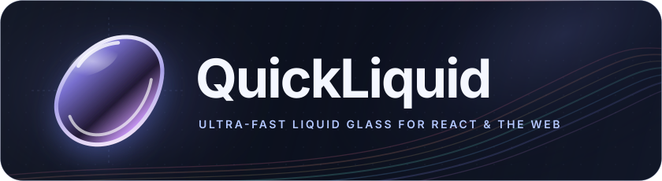
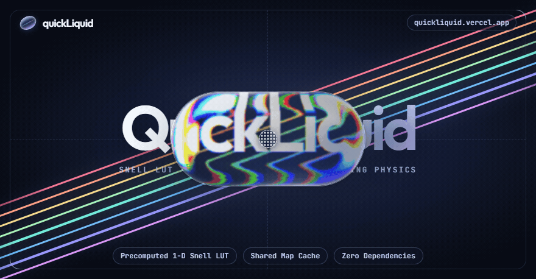
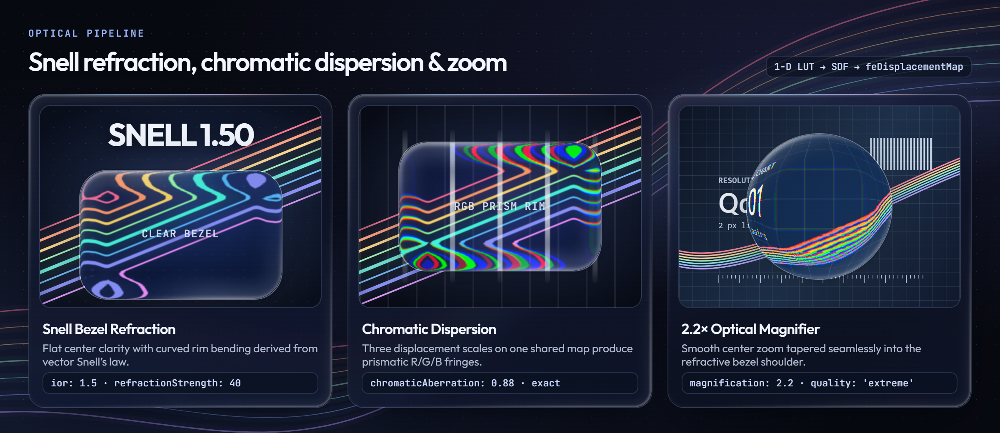
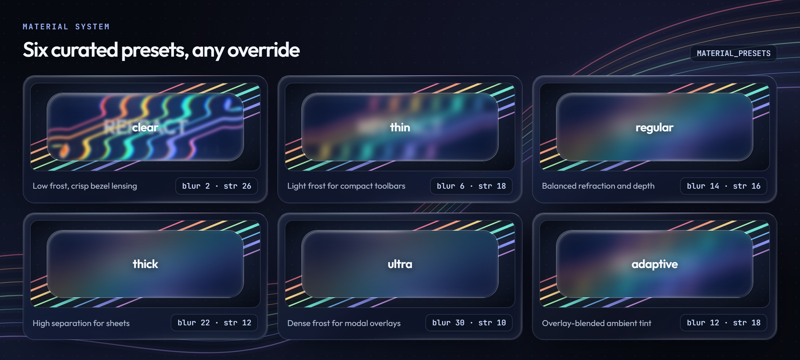
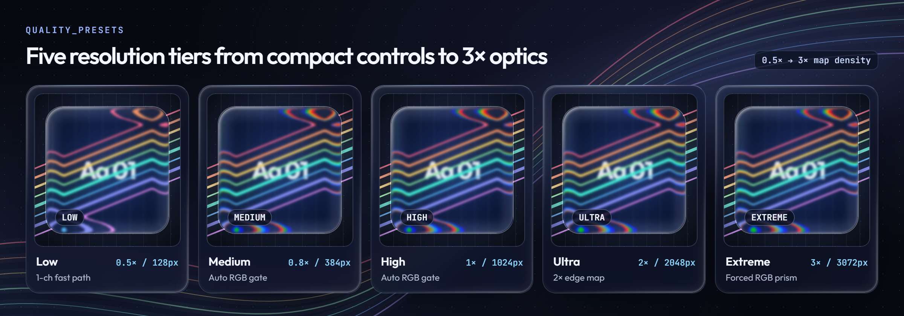
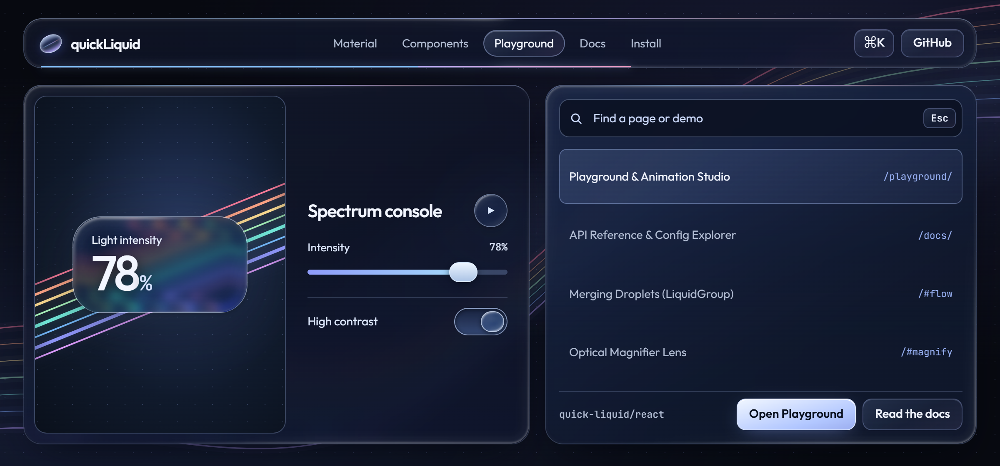
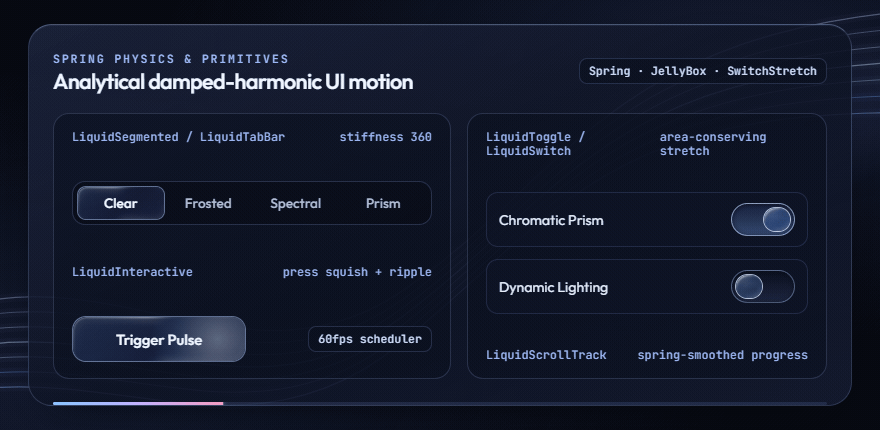
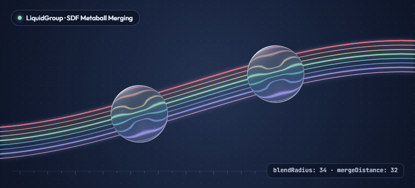

<p align="center">
  
</p>

<p align="center">
  <a href="https://www.npmjs.com/package/quick-liquid"></a>
  <a href="https://bundlephobia.com/package/quick-liquid"></a>
  <a href="https://www.npmjs.com/package/quick-liquid"></a>
  <a href="https://www.npmjs.com/package/quick-liquid"></a>
  <a href="https://www.npmjs.com/package/quick-liquid"></a>
  <a href="https://quickliquid.vercel.app"></a>
  <a href="https://github.com/amarnath3003/quickLiquid/blob/master/LICENSE"></a>
</p>

<p align="center">
  <b>Ultra-fast refractive liquid glass for React and vanilla JavaScript.</b><br />
  Precomputed Snell LUT optics, chromatic dispersion, 1×–3× optical magnification, SDF metaball merging, and spring-driven UI primitives.
</p>

<p align="center">
  <a href="https://quickliquid.vercel.app"><b>Live Site</b></a>
  &middot;
  <a href="https://quickliquid.vercel.app/playground/"><b>Interactive Playground</b></a>
  &middot;
  <a href="https://quickliquid.vercel.app/docs/"><b>API Docs</b></a>
  &middot;
  <a href="https://github.com/amarnath3003/quickLiquid/blob/master/packages/quick-liquid/PHYSICS.md"><b>Physics Notes</b></a>
  &middot;
  <a href="https://github.com/amarnath3003/quickLiquid/blob/master/packages/quick-liquid/OPTIMIZATION.md"><b>Optimization Notes</b></a>
  &middot;
  <a href="https://github.com/amarnath3003/quickLiquid"><b>GitHub</b></a>
</p>

<p align="center">
  <a href="https://quickliquid.vercel.app/playground/">
    
  </a>
</p>

---

## Why QuickLiquid

QuickLiquid is a zero-dependency refractive UI and spring-motion engine for nav bars, command palettes, segmented pills, switches, cards, magnifiers, and merging droplets. It ships as a React primitive suite (`quick-liquid/react`), a full DOM + animation toolkit (`quick-liquid`), and a lean core engine (`quick-liquid/core`).

<table>
  <tr>
    <td width="33%">
      <p align="center"></p>
      <b>Physical Snell refraction</b><br />
      A 1-D Snell lookup table and rounded-rect SDF bend backdrops cleanly through convex bezels while keeping the flat center distortion-free—or zooming up to <code>3×</code> via <code>magnification</code>.
    </td>
    <td width="33%">
      <p align="center"></p>
      <b>Analytical spring physics</b><br />
      Closed-form harmonic springs drive button squish, water ripples, jelly tab pills, droplet switches, directional content swaps, and modal reveals with zero integration drift.
    </td>
    <td width="33%">
      <p align="center"></p>
      <b>Refcounted map cache</b><br />
      Same-geometry glass surfaces share one 8-bit Bayer-dithered displacement map, and strength/dispersion tweaks update filter attributes in place without rebuilding maps.
    </td>
  </tr>
  <tr>
    <td width="33%">
      <p align="center"></p>
      <b>Chromatic prism rims</b><br />
      Red, green, and blue channels sample the same map at physical crown-glass offsets, automatically gated under heavy frost unless <code>dispersionMode: 'exact'</code> or <code>extreme</code> quality is chosen.
    </td>
    <td width="33%">
      <p align="center"></p>
      <b>SDF droplet merging</b><br />
      <code>LiquidGroup</code> paints a shared height-field glass surface with smooth-min bridges, specular rims, and optional 2D canvas backdrop sampling as droplets approach.
    </td>
    <td width="33%">
      <p align="center"></p>
      <b>Drop-in React &amp; DOM UI</b><br />
      Ready-to-use <code>LiquidGlassButton</code>, <code>LiquidSegmented</code>, <code>LiquidToggle</code>, <code>LiquidSwitcher</code>, <code>useLiquidFlow</code>, plus cross-browser <code>opticalSource</code> filtering.
    </td>
  </tr>
</table>

---

## Optics, Dispersion & Magnification

<p align="center">
  
</p>

- **Vector Snell Bezel**: Keeps the flat center readable while bending lines cleanly through rounded corners (`ior`, `bezelWidth`, `thickness`, `refractionStrength`).
- **Chromatic Dispersion**: Three `feDisplacementMap` scales share a single displacement map (`dispersionMode: 'auto' | 'exact'`).
- **Optical Magnification**: Set `magnification` from `1` to `3` to enlarge content smoothly at the lens center.

---

## Material Presets & Quality Tiers

<p align="center">
  
</p>

| Preset | Blur | Refraction | Saturation | Tint Opacity | Best for |
| --- | --- | --- | --- | --- | --- |
| `clear` | `2` | `26` | `1.55` | `0.03` | Hero lenses, docks, and vivid media backdrops |
| `thin` | `6` | `18` | `1.5` | `0.05` | Toolbars, chips, segmented pills, compact controls |
| `regular` | `14` | `16` | `1.7` | `0.09` | Cards, sticky navigation bars, command palettes |
| `thick` | `22` | `12` | `1.8` | `0.13` | Side sheets, popovers, text-heavy panes |
| `ultra` | `30` | `10` | `1.85` | `0.17` | Large modal overlays and elevated surfaces |
| `adaptive` | `12` | `18` | `1.6` | `0.06` | Surfaces using overlay tint blending (`adaptiveTint: true`) |

<p align="center">
  
</p>

| Tier | Density | Longest-side cap | Dispersion behavior |
| --- | --- | --- | --- |
| `low` | `0.5×` | `128 px` | Always single-channel (`1-ch`) |
| `medium` | `0.8×` | `384 px` | Frost-gated RGB (`auto` / `exact`) |
| `high` *(default)* | `1×` | `1024 px` | Frost-gated RGB (`auto` / `exact`) |
| `ultra` | `2×` | `2048 px` | Frost-gated RGB (`auto` / `exact`) |
| `extreme` | `3×` | `3072 px` | Forces full RGB at any positive dispersion |

---

## Install & Quick Start

```bash
npm install quick-liquid
```

Requirements:
- Node 18+ for local builds
- React 18+ only when importing `quick-liquid/react`
- Zero runtime dependencies and no stylesheet import required

### React (`quick-liquid/react`)

```tsx
import { LiquidGlass } from 'quick-liquid/react';

export function CommandCard() {
  return (
    <LiquidGlass
      config={{
        material: 'regular',
        appearance: 'dark',
        quality: 'high',
        borderRadius: 24,
        chromaticAberration: 0.24,
        cursorTracking: true,
      }}
      liquidPress={{ scale: 0.94, squish: 0.03 }}
      animateIn={120}
      className="command-glass"
    >
      <button type="button">Open Command Center</button>
    </LiquidGlass>
  );
}
```

For scenes your React app draws itself, pass a lens-aligned copy of the scenery as the optional `opticalSource` prop on `<LiquidGlass>`. The engine filters that scene directly via SVG, including in browsers without live `backdrop-filter: url()` support.

### Vanilla DOM (`quick-liquid` / `quick-liquid/core`)

```ts
import { LiquidGlassEngine } from 'quick-liquid';

const card = document.querySelector<HTMLElement>('[data-liquid-card]');

if (card) {
  const glass = new LiquidGlassEngine(card, {
    material: 'clear',
    refractionStrength: 28,
    cursorTracking: true,
    quality: 'ultra',
  });

  glass.enableLiquidPress({ scale: 0.94, squish: 0.025 });
}
```

### Configuration updates and cleanup

`updateConfig(patch)` merges explicit overrides (`undefined` clears an override back to preset/default). `setConfig(config)` replaces the full declaration, and `getConfig()` returns the resolved config. Always call `glass.destroy()` when unmounting manually.

```ts
glass.updateConfig({ blur: 8 });
glass.updateConfig({ material: 'regular' }); // explicit blur remains 8
glass.updateConfig({ blur: undefined });    // returns to regular's blur
glass.setConfig({ material: 'clear' });     // reset all overrides
glass.destroy();                           // release resources when the view leaves
```

Vanilla content is wrapped in `.ql-content` for stacking and restored on `destroy()`. Reduced motion and reduced transparency are respected by default in the engine and React wrapper (`respectPreferences: true`); standalone animation utilities should apply application-level preference checks when needed.

---

## React UI Primitives (`quick-liquid/react`)

<p align="center">
  
</p>

| Primitive / Hook | Purpose |
| --- | --- |
| `<LiquidGlass>` | Declarative glass wrapper with `config`, `as`, `active`, `opticalSource`, `liquidPress`, `animateIn`, `jiggle`, `onPerformanceUpdate`, and `LiquidGlassRef`. |
| `useLiquidGlass(config)` | Attaches `LiquidGlassEngine` to any ref and exposes `engine` + `getMetrics()`. |
| `<LiquidGlassButton>` | Non-blocking hover sheen, press squish, expanding water ripple, and optional `glass` lens layer. |
| `<LiquidSegmented>` | Horizontal or vertical segmented control / `tablist` driven by `LiquidTabBar`. |
| `<LiquidToggle>` | Accessible `role="switch"` with `LiquidSwitch` droplet stretch and a `LiquidGlass` thumb. |
| `<LiquidSwitcher>` | Directional spring content transition powered by `LiquidContentSwap`. |
| `useLiquidInteractive(cfg)` | Attaches `LiquidInteractive` hover sheen, magnetic pull, press squish, and ripples to any ref. |
| `useLiquidFlow(cfg)` | Manages `LiquidMorphModal` (`'drop'` or `'flow'`) modal reveals with optical sheen sweeps. |

---

## Spring Physics, Interactive Motion & Metaballs

<p align="center">
  
</p>

QuickLiquid exports analytical closed-form springs (`Spring`, `SpringVector`, `SPRING_PRESETS`, `AnimationScheduler`) alongside ready-to-use UI motion controllers:

- `LiquidInteractive`, `LiquidSwitch`, `LiquidMorphModal`, `LiquidPopover` (+ `bindList`), `LiquidContentSwap`, `LiquidScrollTrack`
- `LiquidTabBar`, `LiquidGroup`, `LiquidGesture`, `LiquidButton`, `LiquidDrag`, `LiquidMorph`, `LiquidMetaball`, `LiquidTransition`, `LiquidLayoutAnimation`
- Pure kinematics helpers: `computeFlowRect`, `computeLiquidDropTransform`, `computeSwitchStretch`, `computeBoundedJellyBox`

<p align="center">
  
</p>

```ts
import { LiquidGroup, LiquidGesture } from 'quick-liquid';

const container = document.querySelector<HTMLElement>('.dock');
const items = document.querySelectorAll<HTMLElement>('.dock-item');

if (container) {
  const group = new LiquidGroup(container, {
    mergeDistance: 32,
    blendRadius: 34,
    bridgeOpacity: 0.78,
    bridgeColor: 'rgba(130, 175, 232, 0.22)',
    bridgeRimColor: 'rgba(232, 246, 255, 0.96)',
  });

  items.forEach((item) => {
    group.add(item);
    new LiquidGesture(item).onDrag(() => group.updatePositions());
  });
}
```

---

## Configuration Reference

| Option | Type | Default | Description |
| --- | --- | --- | --- |
| `material` | `'clear' \| 'thin' \| 'regular' \| 'thick' \| 'ultra' \| 'adaptive'` | unset | Applies a curated glass preset. Explicit keys win. |
| `appearance` | `'light' \| 'dark' \| 'auto'` | `'auto'` | Adapts tint, lighting, and shadow for light or dark backdrops. |
| `blur` | `number` | `3` | Backdrop frost blur in CSS pixels (`0..80`). |
| `saturation` | `number` | `1.5` | Backdrop saturation boost (`0..4`). |
| `tint` | `string` | `'255, 255, 255'` | RGB tint string (`dark` appearance swaps default white to deep smoke). |
| `tintOpacity` | `number` | `0.04` | Material tint opacity (`0..1`). |
| `refractionStrength` | `number` | `22` | Maximum rim displacement in CSS pixels (`0..150`). |
| `bezelWidth` | `number` | `34` | Width of the curved refractive bezel band (`0.5..256`). |
| `thickness` | `number` | `24` | Virtual glass slab depth (`0.1..256`). |
| `ior` | `number` | `1.5` | Index of refraction (`1..3`). |
| `magnification` | `number` | `1` | Center zoom (`1..3`) tapered into the refractive shoulder. Requires SVG refraction. |
| `chromaticAberration` | `number` | `0.18` | Per-channel dispersion split (`0..1`). |
| `dispersionMode` | `'auto' \| 'exact'` | `'auto'` | Skip RGB splitting under heavy frost, or retain exact 3-channel sampling. |
| `lightAngle` | `number` | `-35` | Light direction in degrees (`0` = top). |
| `edgeHighlight` | `number` | `0.9` | Crisp two-lobe rim highlight intensity (`0..1`). |
| `specularStrength` | `number` | `0.26` | Bezel reflection sheen intensity (`0..1`). |
| `fresnelPower` | `number` | `2.2` | Rim lobe tightness (`1..6`). |
| `backdropLuminance` | `number` | unset | Optional `0..1` luminance hint overriding `appearance`. |
| `hoverLighting` | `boolean` | `false` | Brightens rim lighting on hover. |
| `cursorTracking` | `boolean` | `false` | Rotates rim lobes toward the pointer. |
| `dynamicLighting` | `boolean` | `false` | Alias enabling `cursorTracking`. |
| `parallax` | `boolean` | `false` | Adds subtle pointer parallax depth shift. |
| `inertia` | `boolean` | `true` | Spring-smooths interactive light and parallax responses. |
| `elevation` | `number` | `1` | Drop shadow / ambient glow multiplier (`0..5`). |
| `noiseOpacity` | `number` | `0` | Optional micro-noise frost texture opacity (`0..1`). |
| `noiseScale` | `number` | `1` | Scale of the micro-noise texture (`0.1..10`). |
| `borderRadius` | `number` | `28` | Glass corner radius in CSS pixels (`0..10000`). |
| `quality` | `'low' \| 'medium' \| 'high' \| 'ultra' \| 'extreme'` | `'high'` | Map resolution tier (`0.5×/128` up to `3×/3072`). |
| `refractionMode` | `'auto' \| 'svg' \| 'css'` | `'auto'` | Full SVG refraction or explicit CSS frost + lighting fallback. |
| `respectPreferences` | `boolean` | `true` | Honors reduced motion and reduced transparency in the glass engine. |

---

## Import Map

| Import | Exports |
| --- | --- |
| `quick-liquid` | `LiquidGlassEngine`, `DEFAULT_CONFIG`, `MATERIAL_PRESETS`, `QUALITY_PRESETS`, `Spring`, `SpringVector`, `SPRING_PRESETS`, `AnimationScheduler`, `LiquidInteractive`, `LiquidSwitch`, `LiquidMorphModal`, `LiquidPopover`, `LiquidContentSwap`, `LiquidScrollTrack`, `LiquidGroup`, `LiquidTabBar`, `LiquidGesture`, `LiquidButton`, `LiquidDrag`, `LiquidMorph`, `LiquidMetaball`, `generateMergeBlob`, `LiquidTransition`, `LiquidLayoutAnimation`, `computeFlowRect`, `computeLiquidDropTransform`, `computeSwitchStretch`, `computeBoundedJellyBox`, and types |
| `quick-liquid/core` | `LiquidGlassEngine`, `DEFAULT_CONFIG`, `MATERIAL_PRESETS`, `QUALITY_PRESETS`, `GlassQuality`, `LiquidGlassConfig` |
| `quick-liquid/react` | `LiquidGlass`, `useLiquidGlass`, `LiquidGlassButton`, `LiquidSegmented`, `LiquidToggle`, `LiquidSwitcher`, `useLiquidInteractive`, `useLiquidFlow`, `LiquidGlassProps`, `LiquidGlassRef`, and primitive prop types |

Entry points share one map cache within each module format (ESM and CJS remain separate graphs if mixed).

---

## Browser Notes & Performance Model

The full live DOM path depends on `backdrop-filter: url(...)` support and is validated in Chromium. Keep the glass host element free of `isolation`, `filter`, `opacity`, `mask`, and explicit stacking changes on `.ql-lens`. Use `opticalSource` on `<LiquidGlass>` to filter React scenery directly across browsers, or `refractionMode: 'css'` for an explicit frost + lighting fallback.

QuickLiquid uses a cache-first rendering path: a 512-entry 1-D Snell lookup table, bezel-band rasterization with 4-way symmetry, refcounted shared maps, attribute-only scale updates, and rotated pre-baked conic light disks. Read live metrics with `glass.getPerformanceMetrics()`.

---

## Documentation

- [GitHub repository](https://github.com/amarnath3003/quickLiquid)
- [Interactive Playground](https://quickliquid.vercel.app/playground/)
- [Live API Docs](https://quickliquid.vercel.app/docs/)
- [Physics notes](https://github.com/amarnath3003/quickLiquid/blob/master/packages/quick-liquid/PHYSICS.md)
- [Optimization notes](https://github.com/amarnath3003/quickLiquid/blob/master/packages/quick-liquid/OPTIMIZATION.md)

## License

MIT. See [LICENSE](https://github.com/amarnath3003/quickLiquid/blob/master/LICENSE).
